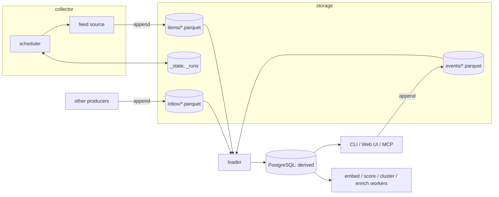
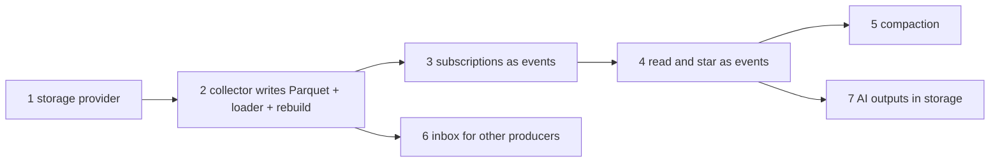

# Parquet store: collector → object storage → viewer

Status: plan, not built. The open decisions listed at the end were settled on 2026-11-08.

## Summary

- tsuzuri moves from "PostgreSQL is the only store" to three roles: a collector that fetches and appends Parquet files to object storage, the object storage itself as the store of record, and a viewer (daemon, CLI, MCP, Web UI) that reads a PostgreSQL database derived from those files.
- PostgreSQL stays required. It holds the search indexes (PGroonga, pgvector) and everything P2 and P3 built, but every row in it can be rebuilt from storage. Dropping the database and running `tsuzuri rebuild` gives the same reader.
- RSS, Atom, JSON Feed and RDF stay, as one way the collector fetches. Other producers can append items in the same Parquet schema to an inbox, and the viewer picks them up the same way.
- The move is done in seven steps, each one a PR that leaves `main` working. Nothing is rewritten from scratch: ingest changes where it writes, and a loader takes over the writes to PostgreSQL.

## Why

- Backups and durability move to the storage provider instead of being a PostgreSQL dump someone has to run.
- The raw articles can be analysed directly with DuckDB or any Parquet reader, without going through the daemon.
- The record is append-only. When extraction or enrichment changes, past items can be reprocessed from what was fetched rather than from what was derived.
- Other collectors can feed the reader by writing files, which a feed (latest run only, capped length) cannot do without losing items fetched between polls.

PostgreSQL is kept rather than reading Parquet directly with DuckDB at view time: DuckDB's full-text search has no morphological analysis and handles Japanese poorly, and fetching from object storage on every page view is slow.

## Fixed constraints

Settled before this plan and not reopened here:

- The store of record is Parquet on S3-compatible storage. Cloudflare R2 is one provider; a local directory (`file://`) is another and is the default for development and tests.
- PostgreSQL is a derived store. Anything that cannot be rebuilt from storage does not live only in PostgreSQL. This is why read and star state move out of it.
- The subscription list lives in storage and is changed from the CLI and the Web UI, with OPML import and export through the same path. No redeploy to add a feed.
- Read and star are appended as events and folded into current state when read. Events are written in batches and compacted daily.
- Items written by other producers into the inbox are an open-source feature of tsuzuri, not a private integration.
- AI stays opt-in (existing constraint). A collector with no AI configured is still a complete feed reader.

## Target shape

- The collector never reads or writes PostgreSQL. It reads the subscription list and its own fetch state from storage, so it can run inside the daemon (default, the existing 30-second scheduler) or alone from cron on another host.
- The loader is the only writer of ingested rows into PostgreSQL. It records which storage objects it has loaded, in PostgreSQL; truncating that table makes it load everything again.
- The viewer writes user actions (subscribe, unsubscribe, read, star) to PostgreSQL immediately so the UI reacts, and appends the same action as an event. The event in storage is the record; the PostgreSQL row is a cache of it.
- The P2 and P3 workers (embedding, interest scoring, clustering, enrichment) keep reading and writing PostgreSQL as they do now. Enrichments and embeddings are also appended to storage (step 7), so a rebuild does not re-run the models.

## Storage layout

Names decided 2026-11-08. They are a public contract, because other producers write to `inbox/`.

| Prefix | Content | Written by | Mutability |
|---|---|---|---|
| `items/dt=YYYY-MM-DD/<runId>.parquet` | Items fetched in one collector run, all subscriptions together | collector | append, compacted |
| `inbox/<producer>/dt=YYYY-MM-DD/<id>.parquet` | Items in the same schema from another producer | other producers | append |
| `events/dt=YYYY-MM-DD/<batchId>.parquet` | Subscription and item-state events | viewer | append, compacted |
| `_runs/<runId>.json` | One record per collector run: requests, items, failures | collector | append |
| `derived/enrichments/`, `derived/embeddings/<model>/` | AI outputs (step 7) | enrichment and embedding workers | append |
| `_state/collector.json` | Fetch state per subscription: ETag, Last-Modified, content hash, recent item ids, next due time, failures | collector | overwritten each run |

- One file per collector run, not per subscription. With a few hundred subscriptions on a 30-minute to hourly cycle, a file per subscription is thousands of small objects a day; one per run is a few dozen. Compaction merges a day into one file.
- `items` carries `source_id` and `fetched_at` on every row, so the many-to-many `item_sources` table is derived from it.
- The collector does not rewrite items it has already written. It keeps the ids of each subscription's recent items in `_state` and skips them. A duplicate that slips past the window (an old item reappearing in a feed) is harmless: the loader's insert is `ON CONFLICT DO NOTHING` today and stays so, and compaction drops exact duplicates.
- `_state` is written after the run's Parquet file, never before. A crash between the two refetches the same items next run, which the previous point makes harmless. The reverse order would advance the ETag past items never stored, which is the failure the current single-transaction ingest exists to prevent.

### Item schema

The Parquet columns are the existing `items` columns that ingest writes (`id`, `url`, `canonical_url`, `title`, `author`, `guid`, `published_at`, `published_at_estimated`, `content_html`, `summary`, `fetched_at`) plus `source_id` and a `schema_version` integer. `search_text` is not stored: the loader derives it, as ingest does now. The schema is documented in `docs/parquet-schema.md` as a public contract, because producers outside this repository write it.

### Events

- One event table, with a `kind` column: `subscribe`, `unsubscribe`, `update_subscription`, `read`, `unread`, `star`, `unstar`, `skip`, `save`. Columns: `event_id`, `kind`, `user_id`, `at`, `item_id` (item events), `source_id` and a JSON `payload` (subscription events: url, kind, config, title).
- Subscriptions are events too, rather than one JSON object rewritten on change. A rewritten object needs a conditional write (`If-Match`) to stop the CLI and the Web UI from overwriting each other; appending events needs no coordination and reuses the item-state machinery. Whether the providers and Bun's client support conditional writes was not checked, because this choice does not depend on it.
- Current state is the last event per (user, item) or per subscription. Daily compaction writes a snapshot of current state and drops the events it covers, so a rebuild reads one snapshot plus the days since.
- The viewer buffers events and flushes them every few seconds and on shutdown. The buffer is spooled to a local file first, so a crash loses nothing that was acknowledged to the user. Without the spool, the PostgreSQL row would show an item as read until the next rebuild silently unread it.

## Steps

Each step is one PR that leaves `main` working, with its own end-to-end check. The rebuild check introduced in step 2 is extended by every later step: perform the step's user actions through the API, drop the database, run `tsuzuri rebuild`, and compare.

### 1. Storage provider

- `packages/store`: a `Storage` interface (`put`, `get`, `list`, `locate`) with `file://` and `s3://` implementations. Bun's built-in S3 client covers any S3-compatible endpoint, R2 included.
- Configuration: `TSUZURI_STORAGE` is `file://<dir>` or `s3://<bucket>`. Credentials and endpoint are the standard AWS names (`AWS_ACCESS_KEY_ID`, `AWS_SECRET_ACCESS_KEY`, `AWS_ENDPOINT_URL_S3`, `AWS_REGION`); R2 is selected by setting the endpoint. The default is `file://./data`, so a first run works with no configuration and the daemon reads what it wrote. The standalone `tsuzuri collect` (step 3) has no default and refuses to start without `TSUZURI_STORAGE`, because a cron job that lost its environment would otherwise write to a directory nobody reads.
- Parquet write and read helpers on `hyparquet` and `hyparquet-writer` (pure JavaScript). Measured 2026-11-08 with Bun 1.4.3 on linux-x64: `@duckdb/node-api` does not survive `bun build --compile` (it requires every platform's binding at bundle time, and with those marked external the binary still fails with `libduckdb.so: cannot open shared object file`), which would rule out single-binary distribution (issue #17). A compiled binary using `hyparquet-writer` wrote and read back STRING, TIMESTAMP (with a null) and INT32 columns, and DuckDB read the same file with identical values, so users can still analyse it with DuckDB.
- No behaviour change. Covers issue #9 (object storage for original HTML) at the interface level; retained HTML can use the same provider later.

### 2. Collector writes Parquet, loader fills PostgreSQL, `rebuild`

- `ingestSource` stops inserting into `items` and `item_sources`. A run collects the normalised items of every due subscription and appends one Parquet file, then writes `_state` and `_runs`.
- Fetch state (`etag`, `last_modified`, `content_hash`, `next_fetch_at`, `consecutive_failures`, `last_error`) moves from `sources` columns to `_state`. The `sources` columns stay readable for `GET /sources` and `doctor`, filled by the loader from `_runs`.
- The subscription list still comes from PostgreSQL in this step: the daemon reads the due subscriptions and passes them to the collector as arguments, so the collector code itself never opens a database connection. Step 3 moves the list to storage, after which the collector can run without the daemon.
- New loader worker: lists objects it has not loaded, inserts items and item_sources, marks the objects loaded. Runs on the scheduler tick after the collector.
- New `tsuzuri rebuild`: drops derived rows and reloads from storage.
- Migration `0007` adds the loaded-objects table. The `sources` fetch-state columns are dropped in step 3, not here, so this step is reversible.

### 3. Subscriptions as events

- `POST /sources`, `DELETE /sources/:id` and OPML import append subscription events and update `sources` in the same request. OPML export reads current state.
- The collector reads the subscription list by folding events from storage, so it no longer needs the daemon. `tsuzuri collect --due` runs it standalone.
- `sources` becomes derived: rebuild recreates it from events.

### 4. Read and star as events

- `POST /items/:id/state` appends item-state events through the spooled buffer and keeps updating `item_state` immediately.
- Cluster-scope reads (D24 in the P3 design: reading a collapsed row reads its members) are written as one event per member item, not one per cluster. Cluster membership is derived and can change on rebuild; the event must record what the user actually marked.
- Interest scoring reads `item_state` as before; its signals survive a rebuild because `item_state` does.

### 5. Compaction

- Daily job: merge yesterday's `items` files into one, and fold events older than a day into a state snapshot.
- Compaction writes the new file before deleting the old ones, and the loader treats an object it has already loaded under another key as loaded (by content, not by key), so a crash in the middle neither loses nor double-loads rows.

### 6. Inbox for other producers

- The loader also lists `inbox/*/`. Rows are validated against the published schema; a file that fails validation is recorded as rejected with the reason and skipped, never partially loaded, and the rest of the inbox continues.
- Items from the inbox appear under a subscription of kind `inbox` per producer, so they can be unsubscribed, filtered and scored like any feed.
- Changes on the producer side are out of scope for this repository.

### 7. AI outputs in storage

Decided 2026-11-08: AI outputs are kept in storage. Enrichments (summary, translation, tags) and embeddings are appended to `derived/enrichments/` and `derived/embeddings/<model>/`, and rebuild loads them instead of recomputing. Clustering, SimHash and interest profiles are recomputed: they are cheap and depend on settings that may have changed.

## Effect on existing issues

| Issue | Effect |
|---|---|
| #9 object storage for original HTML | Interface delivered by step 1; retention policy stays with #9 |
| #17 single-binary distribution | Constrains the Parquet library choice in step 1 |
| #8 Web UI | Unchanged in shape; reads PostgreSQL. Not started before step 4 so it does not have to change its write path twice |
| #30 per-user scoping | Unchanged; events carry `user_id` |
| #14 robots.txt | Moves into the collector unchanged |
| #11, #12, #13 source layers | Run inside the collector. Whether layer 2 (TypeScript plugins) is kept is decided when it is implemented, after counting how much of it other producers writing to the inbox already cover |

## Glossary changes

- collector: the part that fetches subscriptions and appends to storage. Never touches PostgreSQL. `packages/store` consumer, `tsuzuri collect`.
- store of record: object storage. "The store" unqualified means this, not PostgreSQL.
- derived store: PostgreSQL. Everything in it can be rebuilt by `tsuzuri rebuild`.
- loader: the worker that copies storage objects into the derived store.
- inbox: the storage prefix other producers append items to.
- event: one appended user action (subscription or item state). Not a log line.

## Unverified

Checked before or during step 1, not assumed:

- DuckDB reads R2 through a `TYPE s3` secret with a custom endpoint and `s3://` URLs. Another project found `TYPE r2` secrets apply only to `r2://` URLs; whether the generic S3 form works against R2 is not measured.
- `hyparquet-writer` inside `bun build --compile` output on darwin and on arm64 (only linux-x64 was measured).
- Listing cost: R2 counts `ListObjects` as a Class A operation. The loader lists on every tick; at a 30-second tick that is about 86,000 lists a month, under the free tier of one million, but it is an estimate, not a measurement.

## Open decisions

Settled outside this document; recorded here when answered.

- AI outputs in storage: decided 2026-11-08. Enrichments and embeddings are written to storage, because re-running a chat model over every item on each rebuild is not practical. Rejected: recomputing on rebuild, which keeps storage to fetched items and user actions but makes a rebuild cost a full model pass.
- Storage layout names: decided 2026-11-08, the prefixes in the table above. Rejected: a `curated/<collector>/<table>/dt=` layout, which only adds a level for a second collector that does not exist.
- Configuration names: decided 2026-11-08, as written in step 1. Rejected: no default anywhere, which avoids the cron failure but makes the first run fail for everyone.
- Existing data: answered 2026-11-08, no running instance holds data worth keeping. No export tool is built.
